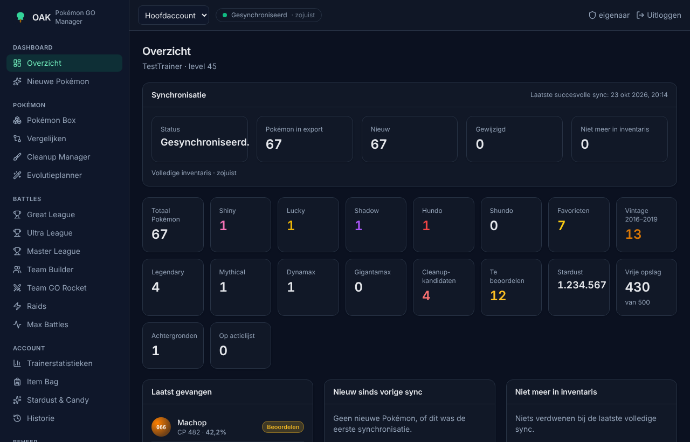
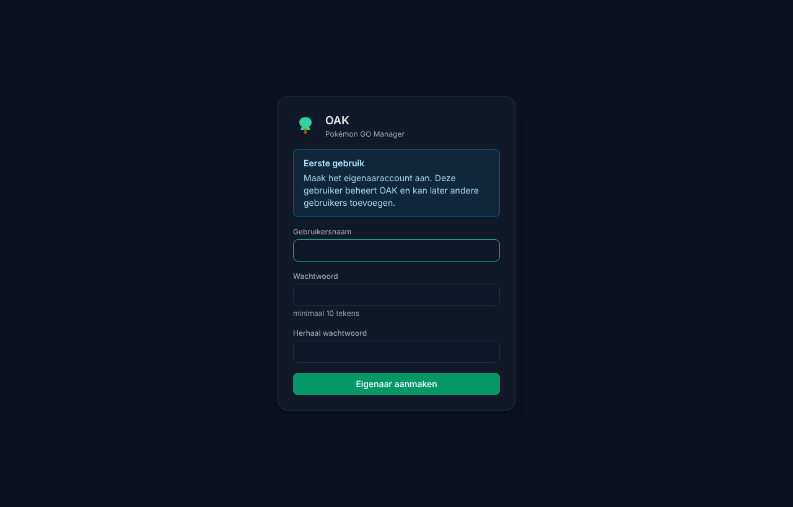
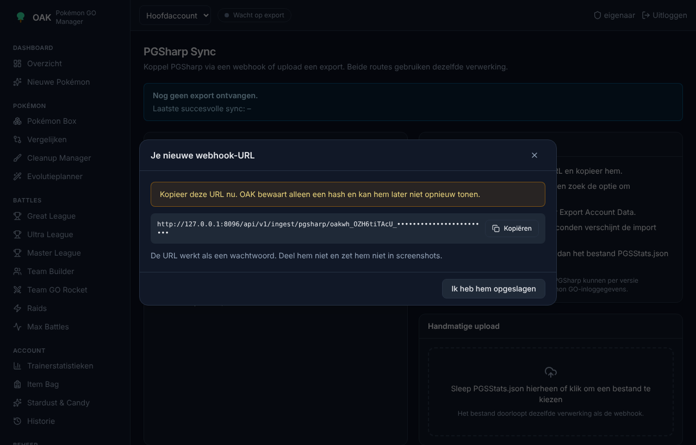
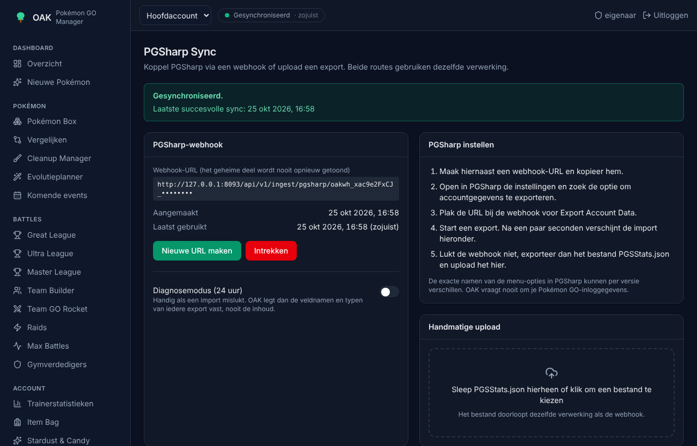
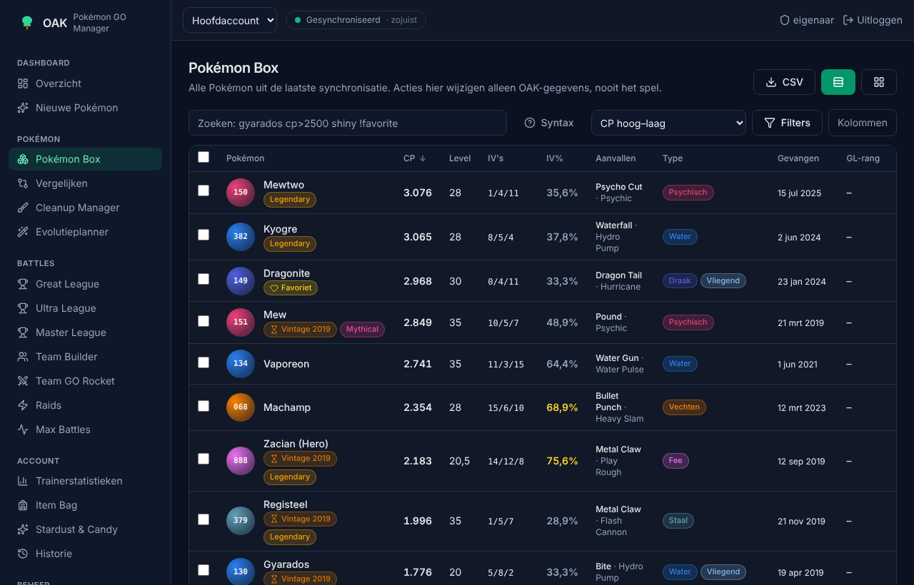
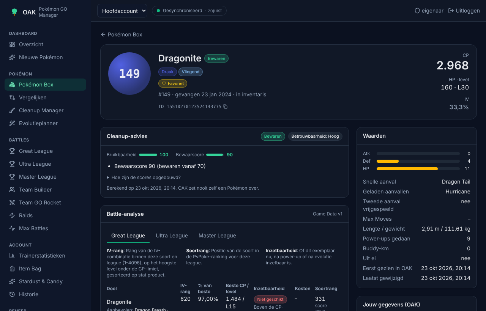
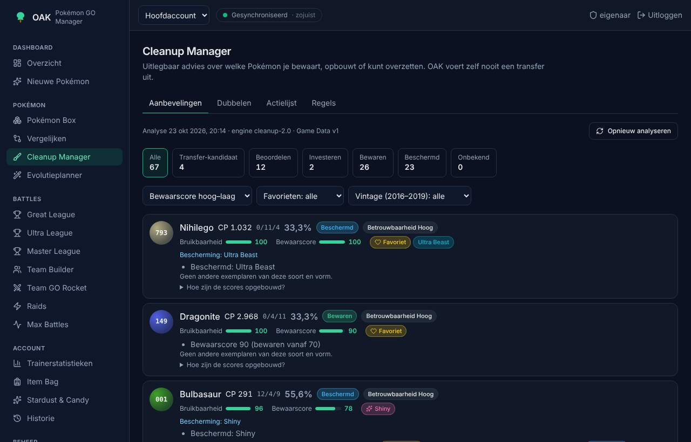
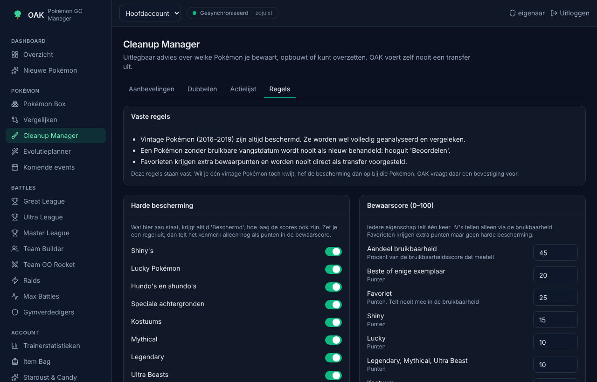
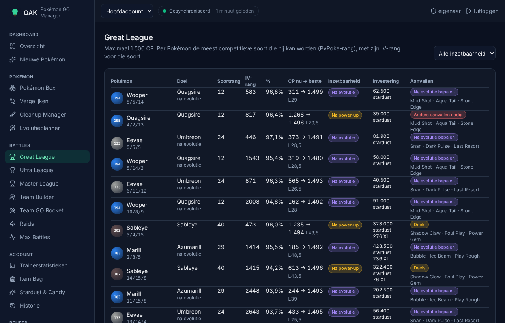

# OAK

OAK is een beheerprogramma voor je Pokémon GO-collectie, dat je op je eigen server draait. PGSharp levert de gegevens van je account. OAK bewaart ze, houdt bij wat er verandert en geeft uitlegbaar advies: welke Pokémon je bewaart, in welke je investeert en welke waarschijnlijk overbodig zijn. OAK voert zelf nooit iets uit in het spel.



> OAK is een niet-officieel communityproject. Het heeft geen band met Niantic, The Pokémon Company, Nintendo, Game Freak of Creatures. PGSharp is een niet-officiële Pokémon GO-client. Het gebruik ervan valt buiten de gebruiksvoorwaarden van Niantic en is op eigen risico.

De screenshots in deze README zijn gemaakt met een synthetische voorbeeldexport en een kleine testset Game Data. De getallen erin zijn daardoor niet representatief voor een echte collectie.

## Inhoud

1. [Wat OAK is](#wat-oak-is)
2. [Functies](#functies)
3. [Wat je nodig hebt](#wat-je-nodig-hebt)
4. [Docker installeren](#docker-installeren)
5. [OAK starten](#oak-starten)
6. [De eerste gebruiker](#de-eerste-gebruiker)
7. [Een traineraccount koppelen](#een-traineraccount-koppelen)
8. [De webhook-URL](#de-webhook-url)
9. [PGSharp instellen](#pgsharp-instellen)
10. [Een export uploaden](#een-export-uploaden)
11. [De Pokémon Box](#de-pokémon-box)
12. [Cleanup](#cleanup)
13. [Analyses lezen](#analyses-lezen)
14. [Back-ups](#back-ups)
15. [Bijwerken](#bijwerken)
16. [Problemen oplossen](#problemen-oplossen)

## Wat OAK is

OAK draait als één Docker-container op je eigen server, NAS of computer. Alles staat in een SQLite-database in de datamap. Je collectie gaat niet naar een externe dienst. Je kunt meerdere Pokémon GO-accounts beheren en OAK met andere mensen delen. Iedere gebruiker ziet alleen de eigen accounts.

OAK vraagt nooit om je Pokémon GO-wachtwoord. Het leest alleen de export die PGSharp maakt.

De interface is Nederlands of Engels. Je kiest de taal rechtsboven in het scherm of op de inlogpagina. Ook de uitleg en meldingen van de server, zoals de redenen in het cleanupadvies, volgen die taal. Alleen de CSV-export, de printbare checklist en een paar itemnamen zijn nog Nederlands.

## Functies

- **Synchronisatie** met PGSharp via een persoonlijke webhook, of door een export te uploaden. Iedere import wordt gecontroleerd op volledigheid, en dubbele imports worden herkend.
- **Overzicht** met aantallen shiny's, lucky's, hundo's, favorieten, vintage Pokémon, nieuwe vangsten en wat er sinds de vorige synchronisatie veranderde.
- **Pokémon Box** met filters, een eigen zoeksyntax, sorteren, kaarten of een tabel, bulkacties op je OAK-gegevens en een CSV-export.
- **Pokédex** om iedere Pokémon uit de Game Data op te zoeken, ook als je hem niet hebt. Je ziet zijn waarden en aanvallen, hoeveel je er hebt en welke Pokémon uit je collectie ernaartoe kunnen evolueren, met de kosten en de CP na evolutie.
- **Detailpagina** per Pokémon met IV's, level, aanvallen, league-analyse, evoluties, power-upkosten, cleanup-advies en historie.
- **Cleanup Manager** met harde en zachte bescherming, twee scores, dubbelen, vergelijkbare exemplaren, een actielijst en zoekteksten voor in het spel. Je kunt filteren op je beste gymverdedigers en op Pokémon die nu in een gym staan.
- **Komende events** uit de kalender van LeekDuck.com. Een Pokémon blijft bewaard tot na de Community Day van zijn evolutielijn, en bij dubbele Transfer Candy krijg je een tip om te wachten.
- **PvP** voor Great, Ultra en Master League en voor cups zoals de Fantasy Cup: IV-rang, soortrang, inzetbaarheid, movesetadvies en een Team Builder. OAK past de regels van iedere cup toe, ook op Pokémon die pas na evolutie mee mogen.
- **PvE**: raidcounters, Team GO Rocket-counters, Max Battles en je beste gymverdedigers.
- **Evolutieplanner** voor evoluties en power-ups, met kosten in Stardust, Candy en XL Candy.
- **Account**: trainerstatistieken, item bag, Stardust en Candy, en de historie.
- **Beheer**: traineraccounts, webhooks, Game Data met versiebeheer, gebruikers, instellingen en back-ups.

## Wat je nodig hebt

- **PGSharp** met de functie **Settings → Export Account Data (Beta)**. Welke versienummers die functie hebben, is niet vastgesteld. Zie [docs/PGSHARP_INTEGRATION.md](docs/PGSHARP_INTEGRATION.md).
- **Een machine met Docker**, bijvoorbeeld een Linux-server, een NAS of een computer met Docker Desktop. De image wordt gebouwd voor amd64 en arm64. De arm64-versie is nog niet op echte hardware getest.
- **Voor de webhook** moet OAK bereikbaar zijn vanaf je telefoon. Dat kan thuis via wifi, of via internet achter een reverse proxy met https. Voor alleen uploaden is dat niet nodig.
- **Internet op de server**, om Game Data en de eventkalender te downloaden. Zonder internet kun je de Game Data ook handmatig uploaden.

## Docker installeren

Op Linux installeer je Docker met het officiële installatiescript:

```bash
curl -fsSL https://get.docker.com | sh
```

Op Windows en macOS gebruik je [Docker Desktop](https://docs.docker.com/desktop/). Controleer daarna of Compose werkt:

```bash
docker compose version
```

Compose moet versie 2.24 of nieuwer zijn. Oudere versies kennen `required: false` bij `env_file` niet en weigeren `compose.yaml`.

## OAK starten

### Met de kant-en-klare image

Maak een map met een `compose.yaml`:

```yaml
services:
  oak:
    image: ghcr.io/arjancool/oak-pogo:latest
    container_name: oak
    restart: unless-stopped
    ports:
      - "8080:8080"
    volumes:
      - ./data:/data
    environment:
      - TZ=Europe/Amsterdam
      - PUID=1000
      - PGID=1000
      - OAK_BASE_URL=http://192.168.1.10:8080
```

Vervang `OAK_BASE_URL` door het adres waarop je OAK opent. Dat adres komt ook in de webhook-URL. Start daarna:

```bash
docker compose up -d
```

Geeft `docker compose up` de melding *denied*, dan staat het pakket op ghcr.io op privé. Log dan eerst één keer in met een GitHub-token dat alleen `read:packages` mag: `docker login ghcr.io`.

### Vanuit de broncode

```bash
git clone https://github.com/arjancool/oak-pogo.git
cd oak-pogo
cp .env.example .env
docker compose up -d --build
```

Alle instellingen staan in `.env.example`. Een reverse proxy, alle omgevingsvariabelen en de beveiliging van de webhook-URL staan in [docs/DEPLOYMENT.md](docs/DEPLOYMENT.md).

Na een halve tot een hele minuut meldt `docker ps` dat de container *healthy* is. Open dan het adres uit `OAK_BASE_URL`.

## De eerste gebruiker

Bij het eerste bezoek vraagt OAK om een eigenaaraccount. Kies een gebruikersnaam en een wachtwoord van minimaal 10 tekens. Er is geen standaardaccount.



De eigenaar beheert de installatie. Andere gebruikers voeg je toe onder **Beheer → Instellingen → Gebruikers**, met een gebruikersnaam en een beginwachtwoord. Na het inloggen maakt iedere gebruiker zelf traineraccounts en webhooks aan. Het eigen wachtwoord wijzig je onder **Wachtwoord wijzigen**. Is een wachtwoord vergeten, dan stelt de eigenaar via **Wachtwoord opnieuw instellen** een nieuw in.

Begint `OAK_BASE_URL` met `https://`, dan stuurt OAK het inlogcookie alleen via https. Open OAK dan ook via dat https-adres.

## Een traineraccount koppelen

Ieder Pokémon GO-account krijgt in OAK een eigen traineraccount. Maak er een aan onder **Beheer → Traineraccounts** en geef het een naam, bijvoorbeeld "Hoofdaccount".

Bij de eerste import koppelt OAK het traineraccount aan het Pokémon GO-account uit de export. Daarna weigert OAK exports van een ander Pokémon GO-account voor dit traineraccount. Wissel je bewust, gebruik dan **Koppeling vergeten**.

Met meerdere traineraccounts kies je bovenaan in het scherm met welk account je werkt.

## De webhook-URL

Open **Beheer → PGSharp Sync** en klik op **Webhook-URL maken**.



Kopieer de URL meteen. OAK bewaart alleen een hash en kan de URL later niet meer tonen. De URL werkt als een wachtwoord: deel hem niet. Is hij uitgelekt, maak dan een nieuwe aan. De oude werkt direct niet meer.

## PGSharp instellen

1. Open in PGSharp **Settings → Export Account Data**.
2. Zet *Send data to server* aan en plak de webhook-URL.
3. Druk op **Test Connection**. OAK antwoordt dan zonder iets te importeren, en onder **PGSharp Sync** zie je bij *Laatst gebruikt* het moment van de test.
4. Log opnieuw in via PGSharp. Volgens de documentatie van PGSAccount verstuurt PGSharp de export bij iedere login. Dat is niet zelf vastgesteld. De synchronisatie is in elk geval niet realtime.
5. Binnen enkele seconden verschijnt de import onder **PGSharp Sync**.



De webhook is nog niet getest met een echte verzending vanuit PGSharp, alleen de lokaal opgeslagen export. Werkt het bij jou niet, zet dan de diagnosemodus aan of gebruik de upload. Zie [docs/PGSHARP_INTEGRATION.md](docs/PGSHARP_INTEGRATION.md).

## Een export uploaden

Zet in PGSharp *Save data to local file* aan en log in. PGSharp slaat dan `PGSStats.json` op je telefoon op. Sleep dat bestand naar het uploadvak op **Beheer → PGSharp Sync**, of klik om het te kiezen. Een upload doorloopt precies dezelfde verwerking als de webhook.

Bij iedere import zie je de status en wat er veranderde: nieuwe, gewijzigde, verdwenen en teruggekeerde Pokémon. Onder **Details** staan de meldingen en een samenvatting van de structuur van de export.

**Volledig of gedeeltelijk.** Een Pokémon die in een nieuwe export ontbreekt, krijgt alleen de status *Niet meer in inventaris* als de import aantoonbaar volledig is. Mist er plotseling meer dan 20 procent én meer dan 25 Pokémon, dan behandelt OAK de import als gedeeltelijk en markeert het niets als verdwenen. Heb je echt veel overgezet, bevestig de import dan als volledig.

## De Pokémon Box

De Box toont al je Pokémon als tabel of als kaarten. Filters staan in de URL, dus een gefilterde weergave kun je als bladwijzer bewaren.



Klik op een Pokémon voor de detailpagina, met IV's, level, aanvallen, de league-analyse, evoluties, power-upkosten, het cleanup-advies en de historie. Bij een Shadow Pokémon kies je of OAK rekent met de Pokémon zoals hij is of zoals hij na purify wordt. Daar leg je ook je eigen gegevens vast: bescherming, notities, OAK-tags en plannen.



### Zoeken

In het zoekveld combineer je termen met een spatie of `&`. Een `!` keert een term om.

| Voorbeeld | Betekenis |
|---|---|
| `gyarados` | Naam, bijnaam of vorm bevat de tekst |
| `cp>2500`, `cp<=1500`, `cp:1000-2000` | CP vergelijken of een bereik |
| `iv>=90`, `atk:0`, `def:15`, `sta:15` | IV-percentage of losse IV's |
| `ivs:15/15/15`, `4*` | Exacte IV's, `4*` is een hundo |
| `shiny`, `lucky`, `shadow`, `purified`, `favorite` | Eigenschappen |
| `legendary`, `mythical`, `ultrabeast`, `dynamax`, `gigantamax` | Klassen en Max-vormen |
| `costume`, `background`, `geruild`, `nieuw`, `verdwenen` | Kostuum, achtergrond, geruild, nieuw, niet meer in inventaris |
| `vintage`, `datumonbekend` | Gevangen in 2016–2019, of zonder bruikbare vangstdatum |
| `2018`, `year<2019` | Vangstjaar |
| `#130`, `dex:130` | Pokédex-nummer |
| `move:hydro`, `type:water`, `family:magikarp` | Aanval, type of familie |
| `great<=100`, `ultra<=100` | IV-rang in Great of Ultra League |
| `bruikbaarheid>=60`, `bewaar<40` | Bruikbaarheids- en bewaarscore |
| `status:transfer_candidate`, `beschermd`, `dubbel` | Cleanup-status, bescherming, dubbelen |
| `!favorite` | Alles behalve favorieten |

Alle zoektermen, ook de Nederlandse varianten zoals `beschermd` en `kostuum`, staan in [docs/QUERY_SYNTAX.md](docs/QUERY_SYNTAX.md).

### Bulkacties

Selecteer Pokémon om ze in één keer te beschermen, te taggen, voor review te markeren of op de actielijst te zetten. Bulkacties wijzigen alleen je OAK-gegevens, nooit het spel. Vintage Pokémon komen nooit via een bulkactie op een transferlijst. Favorieten en Pokémon met een onbekende vangstdatum moet je één voor één bevestigen.

## Cleanup

De Cleanup Manager helpt je de beste exemplaren te bewaren en overbodige exemplaren te herkennen. OAK zet zelf nooit iets over.



Iedere Pokémon krijgt een status:

| Status | Betekenis |
|---|---|
| **Beschermd** | Een harde reden om te bewaren: vintage (2016–2019), handmatig beschermd, een beschermende tag, of een regel zoals shiny of Legendary. |
| **Investeren** | Beste kandidaat voor een league, maar nog power-ups of een evolutie nodig. |
| **Bewaren** | Het beste exemplaar van zijn soort, nuttig in gevechten, of een hoge bewaarscore. |
| **Beoordelen** | Kijk zelf. Bijvoorbeeld een favoriet waarvan een beter exemplaar bestaat, of een twijfelgeval. |
| **Transfer-kandidaat** | Waarschijnlijk overbodig: er blijft een beter of even goed exemplaar bewaard. |
| **Onbekend** | Te weinig gegevens, bijvoorbeeld zonder Game Data. |

**Favorieten** zijn een zachte bescherming. Ze krijgen extra bewaarpunten, worden nooit direct als transfer voorgesteld en komen alleen op de actielijst als je ze per Pokémon bevestigt.

**Vintage Pokémon**, gevangen in 2016 tot en met 2019, zijn altijd beschermd. OAK analyseert en vergelijkt ze wel, zodat je ziet hoe ze zich verhouden tot nieuwere exemplaren.

Bij ieder advies zie je de bruikbaarheidsscore, de bewaarscore, de beschermingsredenen, vergelijkbare Pokémon en de reden. Onder **Hoe zijn de scores opgebouwd?** staat iedere deelwaarde.

OAK houdt rekening met komende events. Een transfer-kandidaat uit de evolutielijn van een Pokémon met een Community Day in de komende twee weken wordt *Bewaren* tot na het event. Onder **Pokémon → Komende events** zie je de kalender, kun je een event negeren en zelf een event toevoegen. De eventgegevens komen van [LeekDuck.com](https://leekduck.com/events/) via [ScrapedDuck](https://github.com/bigfoott/ScrapedDuck).

Onder **Regels** stel je in welke kenmerken hard beschermen, hoeveel punten ieder kenmerk in de bewaarscore waard is en vanaf welke score OAK bewaart of laat beoordelen.



### De actielijst

Zet transfer-kandidaten op de actielijst en werk die daarna zelf in het spel af. Het tabblad **Actielijst** geeft per soort een zoektekst met het Pokédex-nummer en de exacte CP, zodat je de Pokémon in het spel terugvindt. Boven iedere zoektekst staat welke Pokémon het zijn. Je kunt de lijst ook als CSV downloaden of als checklist printen.

Pokémon GO kan niet zoeken op ID. Controleer iedere Pokémon daarom in het spel voordat je hem overzet. Voor de zekerheid sluiten de zoekteksten favorieten, shiny's, lucky's, hundo's, Legendary, Mythical, Shadow en kostuums uit.

## Analyses lezen

OAK houdt een paar begrippen bewust uit elkaar.

- **IV-rang** (1 tot 4096) zegt hoe goed de IV's zijn binnen de soort voor een league. Rang 1 is de beste combinatie.
- **Soortrang** komt uit PvPoke en zegt hoe sterk de soort is in die league. Een rang-1-IV-combinatie van een zwakke soort blijft zwak.
- **Inzetbaarheid** zegt of dit exemplaar nu bruikbaar is, na power-ups of na evolutie.
- **Bruikbaarheidsscore** (0 tot 100) is de feitelijke waarde in gevechten: de hoogste waarde van de leagues, de raidpositie en de positie als gymverdediger. Favoriet en vangstjaar tellen niet mee.
- **Bewaarscore** (0 tot 100) is hoeveel reden er is om te bewaren: een deel van de bruikbaarheid, beste exemplaar, bijzondere kenmerken, favoriet en je eigen plannen.
- **Betrouwbaarheid** zegt hoe zeker het advies is. Laag betekent ontbrekende gegevens, een vorm die OAK niet exact kent of een gedeeltelijke import.



Ieder advies vermeldt de Game Data-versie en de engineversie waarmee het is berekend. Formules en aannames staan in [docs/ANALYSIS_ENGINE.md](docs/ANALYSIS_ENGINE.md).

## Back-ups

OAK maakt voor iedere databasemigratie zelf een back-up. Onder **Beheer → Back-ups** maak en download je er zelf een.

Een volledige back-up van de datamap maak je zo:

```bash
docker compose stop oak
tar czf oak-data-$(date +%F).tar.gz data
docker compose start oak
```

Bewaar `data/.secret_key` mee. Terugzetten en de details staan in [docs/BACKUP_RESTORE.md](docs/BACKUP_RESTORE.md).

## Bijwerken

Met de kant-en-klare image:

```bash
docker compose pull
docker compose up -d
```

Vanuit de broncode:

```bash
git pull
docker compose up -d --build
```

Bij het starten voert OAK database-migraties zelf uit, na een automatische back-up. Is de analyse-engine veranderd, dan berekent OAK alle adviezen opnieuw. De versie staat onder **Beheer → Instellingen**. Wat er per versie veranderde, staat in [CHANGELOG.md](CHANGELOG.md).

## Problemen oplossen

| Probleem | Oplossing |
|---|---|
| De container wordt niet *healthy* | Bekijk `docker logs oak`. Vaak kan OAK niet schrijven in de datamap. Controleer `PUID` en `PGID`. |
| `docker compose pull` geeft *denied* | Het pakket staat op privé. Log in met `docker login ghcr.io`. |
| Na inloggen sta je weer op het inlogscherm | `OAK_BASE_URL` begint met `https://`, maar je opent OAK via http. Open het https-adres, of pas `OAK_BASE_URL` aan. |
| "Te veel mislukte inlogpogingen" | Wacht hooguit een kwartier. Draait OAK achter een reverse proxy, stel dan `OAK_TRUSTED_PROXY_CIDRS` in. |
| De poort is al in gebruik | Kies een andere hostpoort in `ports`, bijvoorbeeld `"8093:8080"`. |
| Geen namen, PvP-rangen of cleanup-advies | Er is nog geen Game Data. Kijk op **Beheer → Game Data**. Zonder internet kun je de bestanden daar uploaden. |
| De import verschijnt niet | Controleer of OAK bereikbaar is op het adres in de webhook-URL en of je opnieuw hebt ingelogd in PGSharp. Upload anders `PGSStats.json`. |
| "Onbekende webhook" | De URL is ingetrokken of vervangen. Maak een nieuwe aan en zet die in PGSharp. |
| "Deze export hoort bij een ander Pokémon GO-account" | Kies het juiste traineraccount, of gebruik **Koppeling vergeten** als je bewust wisselt. |
| De import is gedeeltelijk | Lees de reden bij de import. Klopt de export, bevestig hem dan als volledig. |
| Het bestand is te groot | Verhoog `OAK_MAX_IMPORT_MB`, en de maximale verzoekgrootte van je reverse proxy. |

## Documentatie

| Document | Onderwerp |
|---|---|
| [docs/DEPLOYMENT.md](docs/DEPLOYMENT.md) | Installatie, instellingen en reverse proxies |
| [docs/PGSHARP_INTEGRATION.md](docs/PGSHARP_INTEGRATION.md) | De PGSharp-koppeling en de geverifieerde velden |
| [docs/QUERY_SYNTAX.md](docs/QUERY_SYNTAX.md) | Alle zoektermen van de Pokémon Box |
| [docs/ANALYSIS_ENGINE.md](docs/ANALYSIS_ENGINE.md) | Formules, scores en het cleanup-advies |
| [docs/ARCHITECTURE.md](docs/ARCHITECTURE.md) | Opbouw van de applicatie |
| [docs/DATA_MODEL.md](docs/DATA_MODEL.md) | Database en bestanden |
| [docs/DATA_SOURCES.md](docs/DATA_SOURCES.md) | Databronnen en licenties |
| [docs/SECURITY.md](docs/SECURITY.md) | Beveiliging |
| [docs/BACKUP_RESTORE.md](docs/BACKUP_RESTORE.md) | Back-up en herstel |
| [docs/ROADMAP.md](docs/ROADMAP.md) | Wat klaar is en wat nog komt |
| [docs/adr/](docs/adr/) | Architectuurbesluiten |

Wil je meebouwen, lees dan [CONTRIBUTING.md](CONTRIBUTING.md).

## Licentie

OAK valt onder de [Apache License 2.0](LICENSE) (ADR-0001). Pokémon en alle bijbehorende namen zijn handelsmerken van Nintendo, The Pokémon Company, Game Freak en Creatures. OAK bevat geen Pokémon-afbeeldingen.
